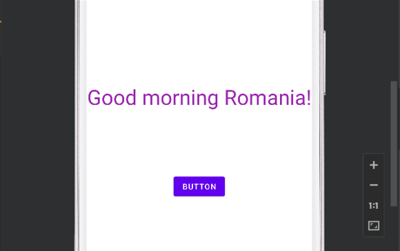
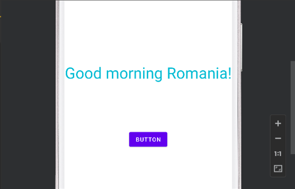
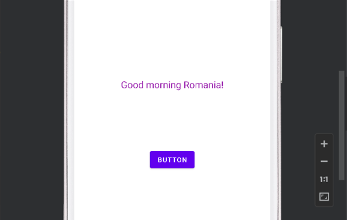

# Aplicație Android – Modificare Text

## 🇷🇴 Română

### 1. Descriere

**Aplicație Android – Modificare Text** este un proiect realizat cu Android Studio, Java și XML. Scopul aplicației este de a demonstra manipularea dinamică a componentelor interfeței grafice și gestionarea evenimentelor generate de utilizator.

Utilizatorul poate modifica aspectul unui text prin două tipuri de interacțiuni cu un buton: apăsare scurtă și apăsare lungă.

## 2. Funcționalități

- Afișarea unui mesaj în interfața aplicației.
- Modificarea culorii textului printr-o apăsare scurtă a butonului.
- Modificarea dimensiunii textului printr-o apăsare lungă a butonului.
- Actualizarea dinamică a interfeței fără repornirea aplicației.
- Gestionarea evenimentelor de tip click și long-click.

## 3. Tehnologii utilizate

| Tehnologie | Utilizare |
|---|---|
| Java | Implementarea logicii aplicației |
| Android SDK | Dezvoltarea aplicației Android |
| XML | Definirea interfeței grafice |
| Android Studio | Mediul de dezvoltare |
| ConstraintLayout | Organizarea componentelor interfeței |
| TextView | Afișarea textului |
| Button | Interacțiunea cu utilizatorul |

## 4. Structura proiectului

```text
Aplicatie-Android-Modificare-Text/
│
├── README.md
├── build.gradle
├── gradle.properties
├── gradlew
├── gradlew.bat
├── settings.gradle
│
├── Images/
│   ├── ecran-initial.png
│   ├── text-culoare-modificata.png
│   └── text-dimensiune-modificata.png
│
├── gradle/
│   └── wrapper/
│       ├── gradle-wrapper.jar
│       └── gradle-wrapper.properties
│
└── app/
    │
    ├── build.gradle
    ├── proguard-rules.pro
    │
    └── src/
        └── main/
            │
            ├── AndroidManifest.xml
            │
            ├── java/
            │   └── com/
            │       └── example/
            │           └── myapplication/
            │               └── MainActivity.java
            │
            └── res/
                │
                ├── drawable/
                │   └── ic_launcher_background.xml
                │
                ├── drawable-v24/
                │   └── ic_launcher_foreground.xml
                │
                ├── layout/
                │   └── activity_main.xml
                │
                ├── mipmap-anydpi-v26/
                │   ├── ic_launcher.xml
                │   └── ic_launcher_round.xml
                │
                ├── mipmap-hdpi/
                │   ├── ic_launcher.webp
                │   └── ic_launcher_round.webp
                │
                ├── mipmap-mdpi/
                │   ├── ic_launcher.webp
                │   └── ic_launcher_round.webp
                │
                ├── mipmap-xhdpi/
                │   ├── ic_launcher.webp
                │   └── ic_launcher_round.webp
                │
                ├── mipmap-xxhdpi/
                │   ├── ic_launcher.webp
                │   └── ic_launcher_round.webp
                │
                ├── mipmap-xxxhdpi/
                │   ├── ic_launcher.webp
                │   └── ic_launcher_round.webp
                │
                ├── values/
                │   ├── colors.xml
                │   ├── strings.xml
                │   └── themes.xml
                │
                └── values-night/
                    └── themes.xml
```

## 5. Capturi de ecran

### Ecranul inițial



### Culoarea textului modificată



### Dimensiunea textului modificată



## 6. Cum funcționează aplicația

Aplicația folosește un `TextView` pentru afișarea mesajului și un `Button` pentru a permite utilizatorului să modifice aspectul textului.

- **Apăsare scurtă:** declanșează modificarea culorii textului.
- **Apăsare lungă:** declanșează modificarea dimensiunii textului.
- **Actualizarea interfeței:** modificările sunt aplicate direct componentei `TextView`.

### Funcționalitatea principală este implementată în `MainActivity.java`:

Următorul fragment ilustrează modul în care este gestionată o apăsare lungă pentru alternarea dimensiunii textului:

```java
        butonulMeu.setOnLongClickListener(new View.OnLongClickListener() {
                    @Override
                    public boolean onLongClick(View v) {
                        if (stareDimensiune == 0) {
                            textulMeu.setTextSize(38);
                            stareDimensiune = 1;
                        } else {
                            textulMeu.setTextSize(20);
                            stareDimensiune = 0;}
                        return true;}});
```

### Funcționalitatea implementată în `activity_main.xml`:

Un `TextView` este definit în fișierul `activity_main.xml` astfel:

```xml
    <TextView
        android:id="@+id/textView"
        android:layout_width="wrap_content"
        android:layout_height="wrap_content"
        android:text="Bună dimineața, România!"
        app:layout_constraintBottom_toBottomOf="parent"
        app:layout_constraintStart_toStartOf="parent"
        app:layout_constraintEnd_toEndOf="parent"
        app:layout_constraintTop_toTopOf="parent" />
```

## 7. Instalare și rulare

### Cerințe

- Android Studio instalat.
- Android SDK compatibil cu proiectul.
- Emulator Android sau dispozitiv Android pentru testare.

### Pași de instalare

1. Clonează repository-ul:

   ```bash
   git clone https://github.com/IonutD3/Aplicatie-Android-Modificare-Text.git
   ```

2. Deschide proiectul în Android Studio.
3. Așteaptă finalizarea sincronizării Gradle.
4. Pornește un emulator sau conectează un dispozitiv Android.
5. Apasă **Run** pentru a compila și lansa aplicația.

## 8. Scopul proiectului

Acest proiect reprezintă un exercițiu practic de inițiere în dezvoltarea aplicațiilor Android. Prin realizarea lui au fost exersate programarea în Java, definirea interfețelor în XML, utilizarea componentelor UI și gestionarea evenimentelor de apăsare scurtă și lungă.

---

# 🇬🇧 English

## 1. Description

**Android Application – Text Modification** is an project developed using Android Studio, Java, and XML. Its purpose is to demonstrate how graphical user interface components can be modified dynamically in response to user interactions.

Users can change the appearance of a text element through two types of button interaction: a short press and a long press.

## 2. Features

- Displaying a message in the application interface.
- Changing the text color with a short button press.
- Changing the text size with a long button press.
- Updating the interface without restarting the application.
- Handling click and long-click events.

## 3. Technologies Used

| Technology | Purpose |
|---|---|
| Java | Application logic |
| Android SDK | Android application development |
| XML | Graphical user interface definition |
| Android Studio | Integrated development environment |
| ConstraintLayout | Arranging interface components |
| TextView | Displaying text |
| Button | User interaction |

## 4. Project Structure

```text
Aplicatie-Android-Modificare-Text/
│
├── README.md
├── build.gradle
├── gradle.properties
├── gradlew
├── gradlew.bat
├── settings.gradle
│
├── Images/
│   ├── ecran-initial.png
│   ├── text-culoare-modificata.png
│   └── text-dimensiune-modificata.png
│
├── gradle/
│   └── wrapper/
│       ├── gradle-wrapper.jar
│       └── gradle-wrapper.properties
│
└── app/
    │
    ├── build.gradle
    ├── proguard-rules.pro
    │
    └── src/
        └── main/
            │
            ├── AndroidManifest.xml
            │
            ├── java/
            │   └── com/
            │       └── example/
            │           └── myapplication/
            │               └── MainActivity.java
            │
            └── res/
                │
                ├── drawable/
                │   └── ic_launcher_background.xml
                │
                ├── drawable-v24/
                │   └── ic_launcher_foreground.xml
                │
                ├── layout/
                │   └── activity_main.xml
                │
                ├── mipmap-anydpi-v26/
                │   ├── ic_launcher.xml
                │   └── ic_launcher_round.xml
                │
                ├── mipmap-hdpi/
                │   ├── ic_launcher.webp
                │   └── ic_launcher_round.webp
                │
                ├── mipmap-mdpi/
                │   ├── ic_launcher.webp
                │   └── ic_launcher_round.webp
                │
                ├── mipmap-xhdpi/
                │   ├── ic_launcher.webp
                │   └── ic_launcher_round.webp
                │
                ├── mipmap-xxhdpi/
                │   ├── ic_launcher.webp
                │   └── ic_launcher_round.webp
                │
                ├── mipmap-xxxhdpi/
                │   ├── ic_launcher.webp
                │   └── ic_launcher_round.webp
                │
                ├── values/
                │   ├── colors.xml
                │   ├── strings.xml
                │   └── themes.xml
                │
                └── values-night/
                    └── themes.xml
```

## 5. Screenshots

### Initial Screen


### Changed Text Color


### Changed Text Size


## 6. How the Application Works

The application uses a `TextView` to display a message and a `Button` to let the user change the text's appearance.

- **Short press:** triggers a text color change.
- **Long press:** triggers a text size change.
- **Interface updates:** changes are applied directly to the `TextView` component.

### The main functionality is implemented in MainActivity.java: 

The following snippet illustrates how a long press is handled to toggle the text size:

```java
        butonulMeu.setOnLongClickListener(new View.OnLongClickListener() {
                    @Override
                    public boolean onLongClick(View v) {
                        if (stareDimensiune == 0) {
                            textulMeu.setTextSize(38);
                            stareDimensiune = 1;
                        } else {
                            textulMeu.setTextSize(20);
                            stareDimensiune = 0;}
                        return true;}});
```

### Functionality implemented in activity_main.xml: 

A TextView is defined in the activity_main.xml file as follows:

```xml
    <TextView
        android:id="@+id/textView"
        android:layout_width="wrap_content"
        android:layout_height="wrap_content"
        android:text="Bună dimineața, România!"
        app:layout_constraintBottom_toBottomOf="parent"
        app:layout_constraintStart_toStartOf="parent"
        app:layout_constraintEnd_toEndOf="parent"
        app:layout_constraintTop_toTopOf="parent" />
```

## 7. Installation and Setup

### Requirements

- Android Studio installed.
- An Android SDK compatible with the project.
- An Android emulator or device for testing.

### Installation Steps

1. Clone the repository:

   ```bash
   git clone https://github.com/IonutD3/Aplicatie-Android-Modificare-Text.git
   ```

2. Open the project in Android Studio.
3. Wait for Gradle synchronization to complete.
4. Start an emulator or connect an Android device.
5. Click **Run** to build and launch the application.

## 8. Project Purpose

This project is a practical introduction to Android application development. It provides experience with Java programming, XML layouts, UI components, and handling short-click and long-click events.

---

## 👤 Autor / Author

**IonutD**
